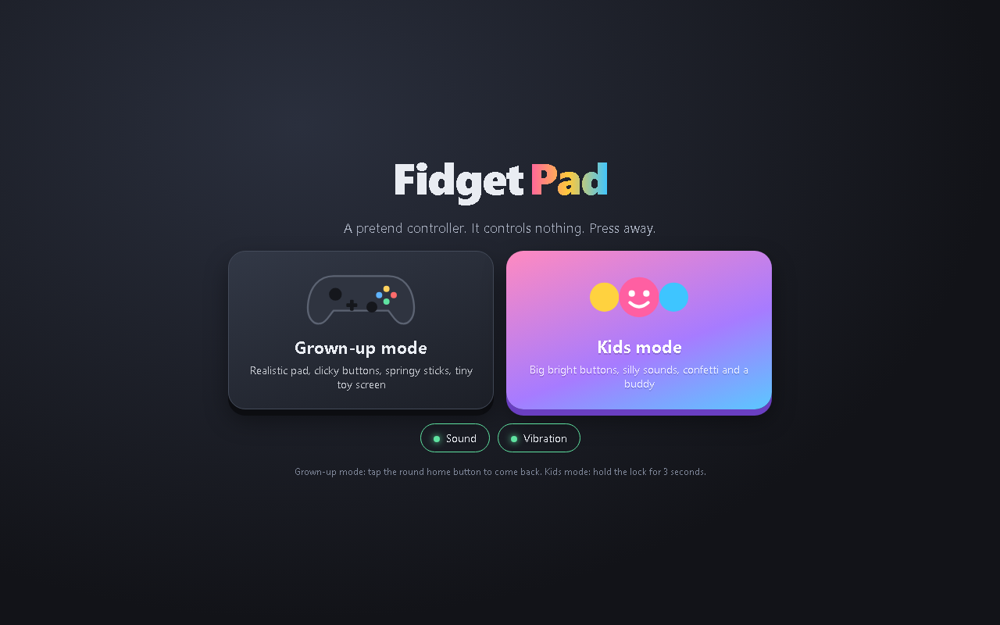

<p align="center"></p>

<p align="center">    </p>

A pretend game controller that controls nothing, made for fidgeting. The grown-up mode is a realistic controller with springy thumbsticks and a tiny game to play on its mini screen. The kids mode has big bright buttons, silly sounds, confetti and a buddy who reacts to every press.

<p align="center"></p>

## Features

- Original controller design with springy analog sticks (tap to click), d-pad with diagonals, face buttons, bumpers and triggers
- Click sounds, haptics and press animations on every button
- Mini screen with a dot game (steer, double-jump, dash, collect stars) or an input visualiser
- Kids mode: six candy buttons with silly sounds, confetti, stars and hearts, and a reacting buddy
- Full multitouch so several buttons work at once
- Parent lock (hold for 3 seconds), rotate prompt in portrait, zoom and scroll blocked

## Getting started

No build step and no dependencies. Clone the repo and open `index.html`, or serve the folder locally:

```bash
git clone https://github.com/Squidly1408/fake-controller.git
cd fake-controller
python -m http.server 8797
```

Then visit http://localhost:8797.

## Project structure

| File | Purpose |
|---|---|
| `index.html` | App shell |
| `app.js` | Controller, mini game and kids mode logic |
| `style.css` | Styles |
| `assets/` | Logo and README images |

## Built with

HTML, CSS, JavaScript (Pointer Events, Web Audio API, Vibration API)

## Limitations

- Vibration does not work on iPhone (Safari)
- Landscape lock only works on Android in fullscreen
- Kids mode cannot block the home gesture; use Guided Access or screen pinning

## License

Released under the [MIT License](LICENSE).
